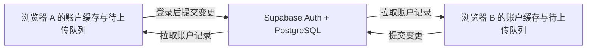

# 账户缓存与跨浏览器同步

网站继续部署在 GitHub Pages。Supabase Auth 提供家长邮箱登录、注册确认、重设密码与会话续期，PostgreSQL 保存每个账户的共享记录。未登录时沿用原有本浏览器记录，学习无需账号。

## 数据流

同步包含 `sparks_learning_v2` 中的接触词、听读复习证据、错题、课程完成、学习日计数、练习记录、草稿、自查和每日计划；另同步 `sparks_activity_*` 课程断点、发音偏好、当前单元和进阶课程展开偏好。临时录音、搜索输入和旧版 `ket_*` 记录不上传。

每个账户使用 `sparks_sync_cache_v1:{userId}` 缓存云端基线，每条变更独立放在 `sparks_sync_outbox_v1:{userId}:{operationId}`。原有游客存储键不会被账户进度覆盖。切换身份时重新挂载学习页面，清理练习中的临时状态及录音资源。

本地变更立即保存，700ms 内合并触发一次上传；前台每 30 秒拉取，并在窗口重新聚焦、页面重新可见、联网和用户点击“立即同步”时刷新。已经打开的页面断网仍可学习。待上传队列在刷新后恢复；离线从零打开网站仍需要页面资源缓存，这次没有提供离线站点安装包。

## 事务与合并

`read_learning` 在当前登录用户的行上加共享锁，读取基线版本及本批次已确认的操作 ID。客户端将尚未确认的变更合并到该基线，再调用 `commit_learning`。后者在一笔事务中锁定账户行、比较版本、保存新快照并登记操作 ID。版本冲突则重新拉取合并，单次最多重试六次，剩余工作保留到下一轮。

操作 ID 永久保留用于去重。服务器提交成功但网络丢失回复时，下次读取确认记录后不会重复增加答题次数。客户端先持久化新基线，再删除已确认的本地操作；缓存写入失败时保留操作，显示明确的存储错误提示。每批最多 100 项，快照最大 4 MiB。

| 数据 | 合并规则 |
| --- | --- |
| 接触词、已完成课程 | 合并新增 ID，保留其他浏览器已有记录 |
| 学习日答题次数 | 累加新增次数，依赖操作 ID 去重 |
| 练习历史 | 按练习 ID 去重，按日期保留最近 100 条 |
| 听读复习状态 | 按“题目/单词 + 技能”保存最新作答状态；较新的离线作答用现有排期规则重放，保留旧证据并重新检查到期日和四小时间隔；不拼接步骤或成功日期生成掌握证据；相同作答时间的错误优先 |
| 掌握及错题 | 从所选听读状态重新计算，较早的成功不能覆盖较新的错误 |
| 写作草稿 | 修改基线一致时替换；同时修改时保留云端正文及另一份可复制的草稿副本 |
| 固定每日计划 | 保留先确认的计划；只允许兼容的追加复习批次，最多投影最近 90 天 |
| 活动断点 | 相同题组保留较远的位置；同位置允许本次修改，已完成的活动可重新开始 |
| 发音偏好 | 按改变的字段合并；真正冲突时保留已确认的云端字段 |

听读记录时间来自设备。不同设备时钟偏差可能影响同一技能的“最新作答”选择。并发离线学习同一技能时只重放较新的作答；过时作答不覆盖新状态，不保证恢复每一份离线独立成功证据；不同单词、不同技能及历史练习分别保留。推荐让孩子在一个浏览器做完活动，再在另一浏览器续学。

## 已有记录迁移

第一次登录后，点击“导入本浏览器原有记录”。每份游客记录使用稳定的迁移 ID，每个账户只导入一次，重复点击或失败重试不会重复累计学习日次数。该操作不会删除或覆盖游客原始记录；导入前请确认登录的是孩子要使用的账户。登录另一浏览器时直接使用同一邮箱账户，无需再次导入空记录。

## Supabase 开通与发布

本项目已经接入 `https://oeyirzlgqixvcxofimit.supabase.co`。2026-10-12 已通过管理连接执行 `supabase/migrations/202610120001_account_sync.sql`，并把 Site URL 和允许的 Redirect URL 设置为 `https://baokaijian.github.io/KET/`。邮箱确认保持启用。

以后复制到其他项目时：

1. 创建 Supabase 项目，启用 Email 登录。保留邮箱确认。默认邮件服务只能发送到 Supabase 组织成员的邮箱，目前限每小时 2 封；向其他家长开放注册前，必须在 Authentication → Emails → SMTP Settings 配置自己的邮件服务。填写服务商提供的 SMTP 主机、端口、用户名、密码以及已验证的发件邮箱，敏感凭据只填在 Supabase 控制台。详见 [Supabase 邮件服务配置](https://supabase.com/docs/guides/auth/auth-smtp)。
2. 在 SQL Editor 中执行迁移脚本，或使用 Supabase migrations 工作流应用该文件。
3. Authentication → URL Configuration：Site URL 与 Redirect URLs 设置为实际 GitHub Pages 地址，包含项目路径及末尾 `/`。本地注册/找回密码调试时另添加实际开发地址。
4. Project Settings → API Keys：复制 project URL 与公开 publishable key。只使用公开客户端密钥；不要在 `VITE_*`、仓库或前端填入 service role、secret key 或数据库密码。
5. 修改 `.env.production`；本地复制 `.env.example` 为 `.env.local` 并填写公开值。GitHub Actions 可通过同名 repository variables 覆盖当前默认配置：`VITE_SUPABASE_URL`、`VITE_SUPABASE_PUBLISHABLE_KEY`。部署工作流读取这两个值后构建静态前端。
6. 在 GitHub 仓库 Settings → Pages 将 Source 设为 GitHub Actions。推送默认分支，等待 GitHub Pages 工作流成功。在网站右上角“账户与同步”中注册、确认邮箱、登录并导入记录，再用其他浏览器登录同一账户验证。

公开密钥会出现在网站构建资源中，这是预期行为。权限由 RLS 和数据库函数中的 `auth.uid()` 校验负责。[Supabase RLS 文档](https://supabase.com/docs/guides/database/postgres/row-level-security)说明了公开客户端访问与账户隔离机制。

两个同步函数有意使用 `SECURITY DEFINER`，因此 Supabase Advisor 会提示已登录用户可执行它们。它们只接受 `auth.uid()` 作为账户标识、不接受外部 user ID、设置空 `search_path`，并撤销匿名调用和客户端直接写表权限。该提示属于本方案有意开放的事务入口，不能据此声称所有 Advisor 提示都消失。

## 验证与运行边界

- `npm run test:data`：包含缓存重启、两个浏览器的并发提交、丢失回复的幂等重试、一次性游客迁移、账户隔离、存储失败、草稿冲突和课程断点回退验证。
- 数据库测试用 PGlite PostgreSQL 执行原封不动的生产迁移；验证 SQL 事务、RLS、函数调用权限、版本检查和无效负载拒绝。
- `npm run test:sync`：两个独立浏览器存储上下文，在桌面与手机布局下通过官方 Supabase 客户端走 HTTP；Auth 是测试替身，同步 RPC 实际执行生产 SQL。不是线上注册邮件收件或真实设备音色的验收。
- `npm run test:e2e`、`npm run test:pages`：验证原有学习路径和 GitHub Pages `/KET/` 子路径。
- CI 发布新增同步检查；全部检查通过才发布。

服务数据保存在 Supabase，网站没有账户注销界面或后台家长管理界面。云端恢复依赖该项目的备份策略。当前按个人/家庭规模实现，每次同步读取一个账户快照；大量用户或快照接近大小上限时，应拆分为按活动的记录表和增量读取，去重记录也需要配套归档策略，不能直接删除后重用旧操作 ID。
